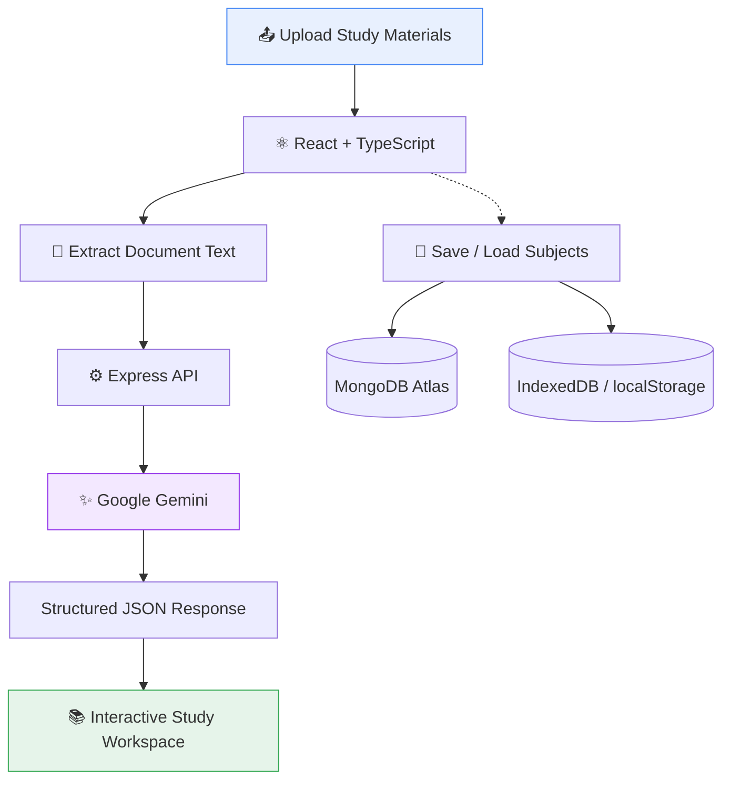
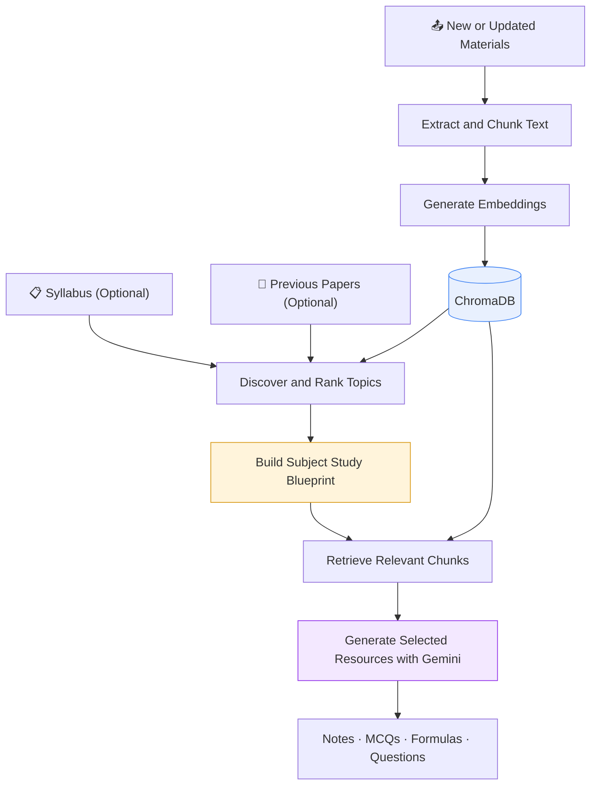

<div align="center">

#  Smart Study Assistant V2

### Your study material. Your syllabus. Your personalized study workspace.

Transform lecture notes, syllabi, and previous-year papers into structured, exam-focused study resources with Google Gemini.

<br/>


**AI-Powered Learning · Document Processing · Personalized Study Resources**

</div>

---

## ✨ Features

| Feature | Description |
|:--|:--|
| 📚 Subject Workspace | Create, save, reopen, rename, and manage subjects. |
| 📄 Multi-Format Uploads | Upload notes, syllabi, and previous-year papers. |
| 🧠 AI Study Generation | Generate detailed notes, MCQs, formulas, diagrams, hot questions, and question papers. |
| 🧩 Structured Responses | Use Gemini's response schema to produce structured JSON for the UI. |
| 💾 Persistent Storage | MongoDB Atlas for cloud storage, with browser-storage fallbacks. |

## 🛠️ Tech Stack

| Layer | Technologies |
|:--|:--|
| Frontend | React, TypeScript, Vite |
| Backend | Node.js, Express |
| AI | Google Gemini API, `@google/genai` |
| Document Parsing | PDF.js, Mammoth, SheetJS, JSZip |
| Data Storage | MongoDB Atlas, Mongoose, IndexedDB, localStorage |
| UI | Tailwind CSS utility classes, Lucide React |

## ⚙️ How It Works

### Current Architecture



### 📎 Document Processing

| Format | Extraction Method |
|:--|:--|
| PDF | PDF.js |
| DOCX | Mammoth |
| PPTX | JSZip + XML text extraction |
| XLSX / XLS / CSV | SheetJS |
| TXT / MD / JSON / JS / TS | TextDecoder |
| Legacy binary files | Best-effort text extraction |

## 🧪 Planned: Subject-Aware RAG

The next stage is to make each subject continuously useful as new materials are uploaded—without requiring users to write prompts for every generation.



> **RAG, embeddings, ChromaDB retrieval, and automatic topic analysis are planned features—not yet implemented in the current version.**

## 🚀 Run Locally

**Prerequisites:** Node.js, npm, and a Google Gemini API key.

**1. Install dependencies**

```bash
npm install
```

**2. Configure environment variables**

Set `GEMINI_API_KEY` in your server environment. Set `MONGODB_URI` if you want MongoDB Atlas persistence.

Never commit real API keys or database credentials.

**3. Start the application**

```bash
npm run dev
```

Open **http://localhost:3000**.

**4. Production build**

```bash
npm run build
npm start
```

## 🗂️ Project Structure

```text
smart-study-assistant/
├── App.tsx                    # Main React application
├── types.ts                   # TypeScript data models
├── index.tsx                  # React entry point
├── components/
│   └── ResultsView.tsx        # Study-resource interface
├── services/
│   └── geminiService.ts      # Generation request handling
├── src/
│   ├── utils/
│   │   ├── fileParser.ts     # Document text extraction
│   │   └── db.ts             # IndexedDB helpers
│   └── models/
│       └── Subject.ts        # MongoDB subject model
├── server.ts                  # Express API and Gemini integration
└── vite.config.ts             # Development configuration
```

## 🗺️ Roadmap

- [ ] Improve document validation, parsing, and error handling.
- [ ] Implement chunking, embeddings, and ChromaDB retrieval.
- [ ] Build automatic topic discovery and subject-level analysis.
- [ ] Incorporate syllabus and previous-paper evidence when available.
- [ ] Retrieve relevant source chunks for grounded study generation.
- [ ] Add source references and automated tests.

## ⚠️ Current Limitations

- Scanned PDFs may require OCR, which is not currently implemented.
- Large document collections can cause slow generation and request failures.
- Legacy binary extraction may lose content or document structure.
- The login screen is a UI mock, not real authentication.
- AI-generated content and exam-style questions require verification against course materials.

---

<div align="center">

**Built with React, TypeScript, Google Gemini, a roadmap toward retrieval-augmented study generation, AND WITH PASSION !!!.**

</div>
